# Module 6: Service Discovery, Readiness and Recovery

## What I Built

In this lab I ran a small app on Kubernetes using minikube. There are three parts:

- **Inventory Service**: a small Flask app that runs as 2 copies (replicas).
- **Service (`inventory-service`)**: one fixed name and address that sends traffic to the Inventory Pods.
- **Client**: a small program that calls `http://inventory-service/inventory` every second and prints which Pod answered.

I tested three things:
1. Does the client reach both Pods using only the Service name?
2. What happens when one Pod is not ready?
3. What happens when I delete one Pod?

## Simple Architecture

```
                http://inventory-service/inventory
┌──────────────────┐                              ┌─────────────────────────┐
│ inventory-client │ ───────────────────────────► │ Service                 │
│ (1 Pod)          │      (uses the name only)    │ inventory-service:80    │
└──────────────────┘                              │ ClusterIP 10.110.64.237 │
                                                  └────────────┬────────────┘
                                                               │ label: app=inventory
                                                  ┌────────────┴────────────┐
                                                  ▼                         ▼
                                        ┌──────────────────┐     ┌──────────────────┐
                                        │ Inventory Pod 1  │     │ Inventory Pod 2  │
                                        │ port 8080        │     │ port 8080        │
                                        └──────────────────┘     └──────────────────┘
                                              (Deployment with 2 replicas)
```

How it works, in short:
- The client only knows the Service name. It never uses a Pod IP.
- The Service finds Pods using the label `app=inventory`.
- Only Pods that are **ready** get traffic.

## Project Files

```
.
├── README.md
├── app/         # Inventory app (Flask) and its Dockerfile
├── client/      # Client app and its Dockerfile
├── k8s/         # Kubernetes YAML files
└── Evidences/   # Screenshots and text logs
```

## What You Need

- Docker (I used Colima), kubectl, and minikube
- I tested on a Mac with Apple Silicon, minikube v1.39.0, Docker driver

## How to Deploy

**1. Start the cluster**
```bash
minikube start --driver=docker
kubectl get nodes
```

**2. Build the images and load them into minikube**

My minikube uses containerd, so I did not use `docker-env`. I build with Docker and then load the images.
```bash
docker build -t inventory-app:1.0 ./app
docker build -t inventory-client:1.0 ./client
minikube image load inventory-app:1.0
minikube image load inventory-client:1.0
```

**3. Deploy everything**
```bash
kubectl apply -f k8s/inventory-deployment.yaml
kubectl apply -f k8s/inventory-service.yaml
kubectl apply -f k8s/client-deployment.yaml
```

**4. Check that it works**
```bash
kubectl get pods -o wide
kubectl get svc
kubectl get endpoints inventory-service
kubectl logs -f deployment/inventory-client
```

## Part 1: Deployment and Service Discovery

First I checked that the cluster is ready.

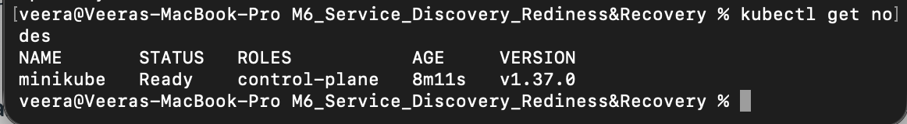

Then I built the images and loaded them into the cluster.

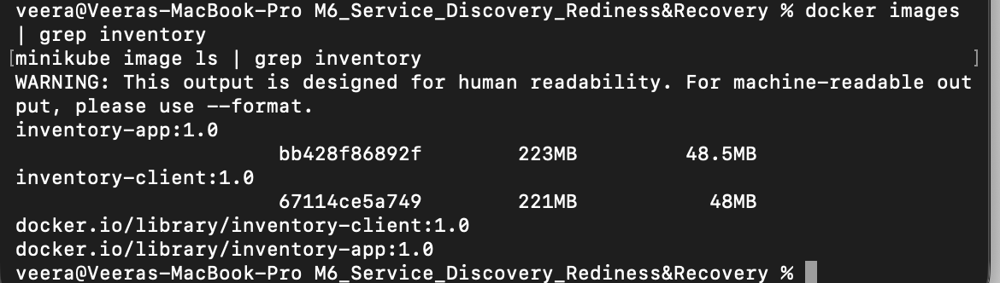

Both Inventory Pods and the client are running (`1/1 Running`).

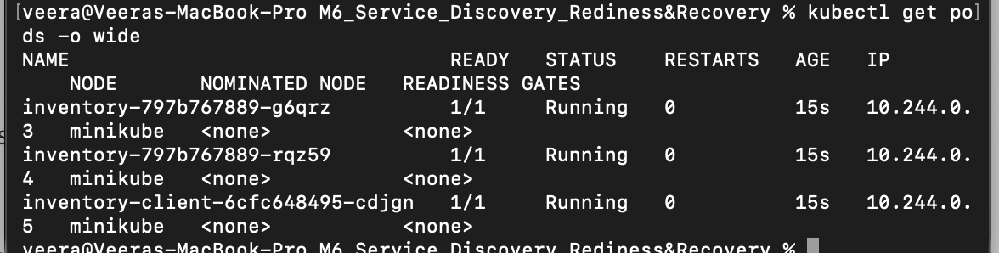

The Service has two Pod IPs in its endpoints. This means it knows about both Pods.

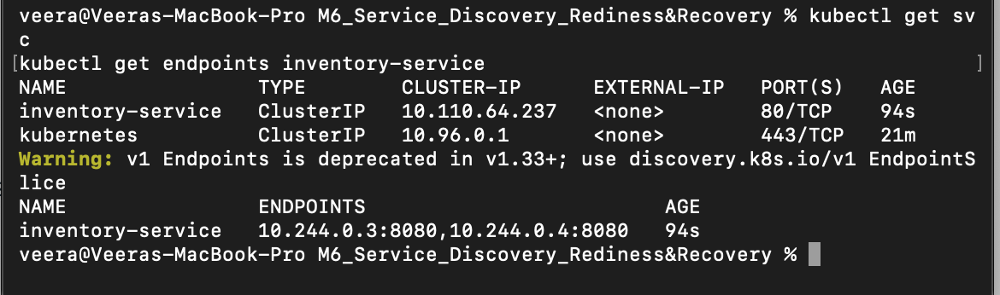

The client logs show answers from two different Pods.

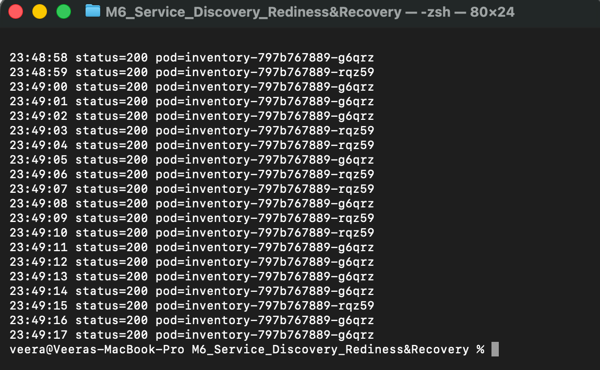

I counted the requests for each Pod. Both got traffic (124 and 143 in my first count). The numbers are not equal because Kubernetes picks a Pod randomly for each new connection.

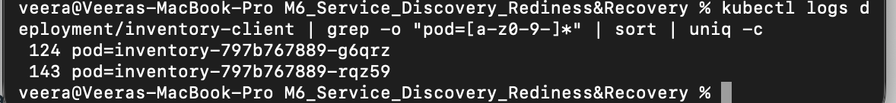

The client code uses the Service name, not a Pod IP: `URL = "http://inventory-service/inventory"`.

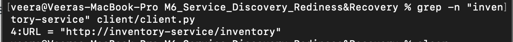

Text files: `service-describe.txt`, `client-logs-initial.txt`, `request-distribution.txt` (in `Evidences/`).

## Part 2: Readiness Test

The Inventory Deployment has a readiness probe. It calls `/ready` on port 8080 every 3 seconds. My app has a special URL, `/set-ready/false`, so I can make one Pod "not ready" on purpose.

I used it on the Pod `inventory-797b767889-g6qrz`:

```bash
kubectl exec $POD1 -- python -c "import urllib.request; print(urllib.request.urlopen('http://localhost:8080/set-ready/false').read())"
```

**The Pod is still running.** It shows `0/1 Running` and 0 restarts. The other Pod stays `1/1`.

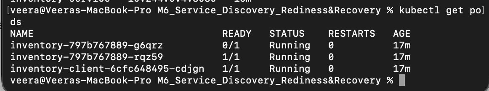

**The Service removed the unready Pod.** Only one endpoint IP is left.

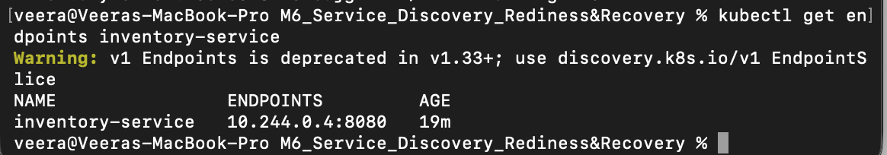

**The events show the readiness probe failing** with HTTP status 503.

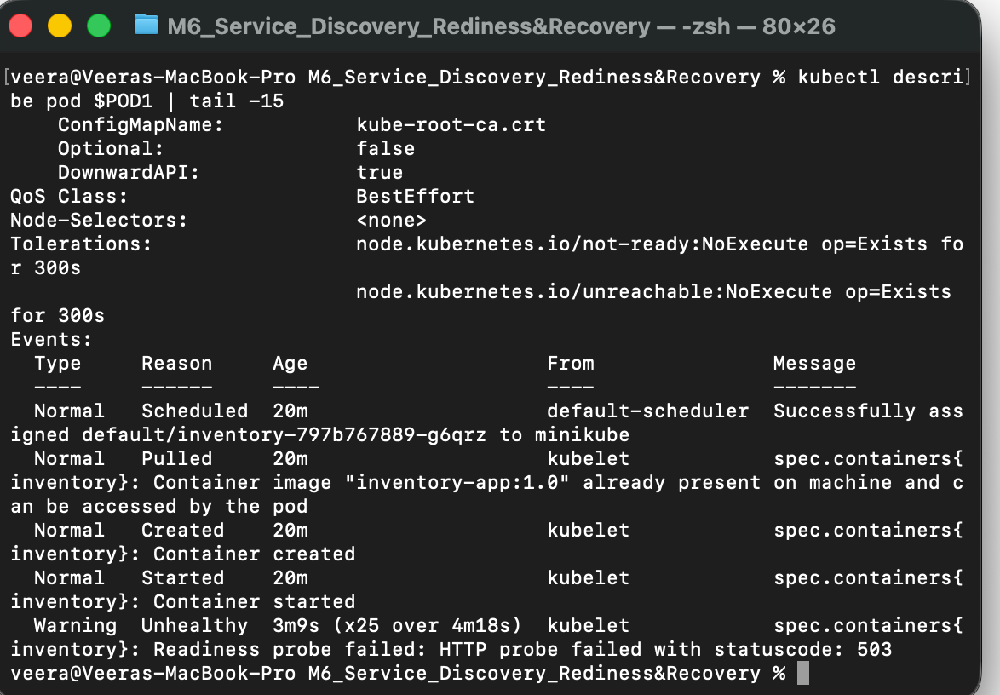

**All client requests went to the ready Pod only** (`rqz59`). The unready Pod got no traffic.

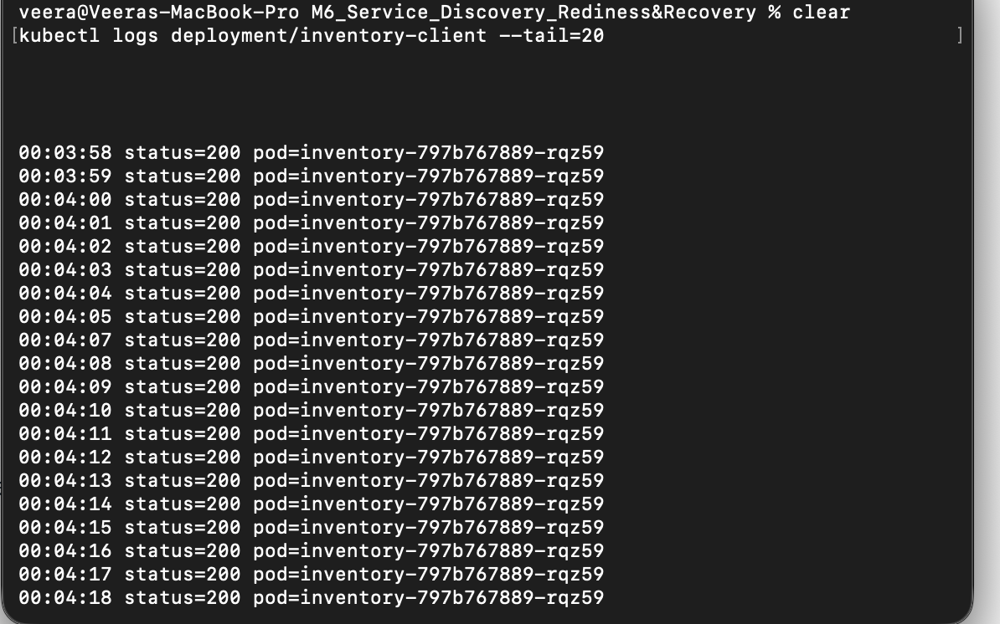

**The unready Pod is still alive.** It has `RESTARTS 0`, and `/healthz` answers `alive`.

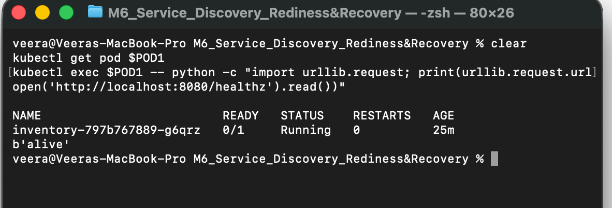

Then I restored readiness with `/set-ready/true`.

**Both Pods are `1/1 Running` again, and both endpoints are back.**

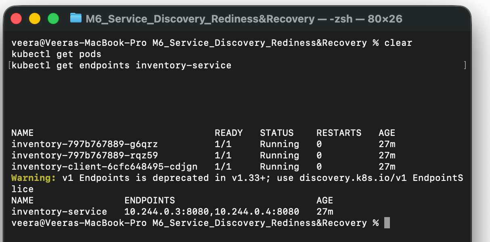

**The client gets answers from both Pods again.**

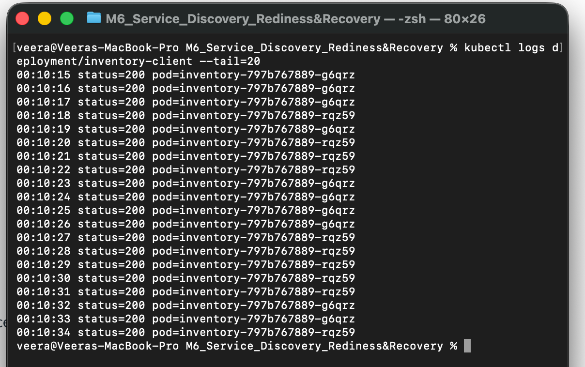

Text files: `pods-unready.txt`, `endpoints-unready.txt`, `pod-describe-unready.txt`, `client-logs-unready.txt`, `last-request-to-unready-pod.txt`, `pods-restored.txt`, `endpoints-restored.txt`, `client-logs-restored.txt` (in `Evidences/`).

## Part 3: Pod Failure and Recovery

I deleted the Pod `inventory-797b767889-g6qrz` (IP `10.244.0.3`):

```bash
kubectl delete pod $POD1
```

**Before deleting:** two Pods, the Service ClusterIP is `10.110.64.237`, and there are two endpoints.

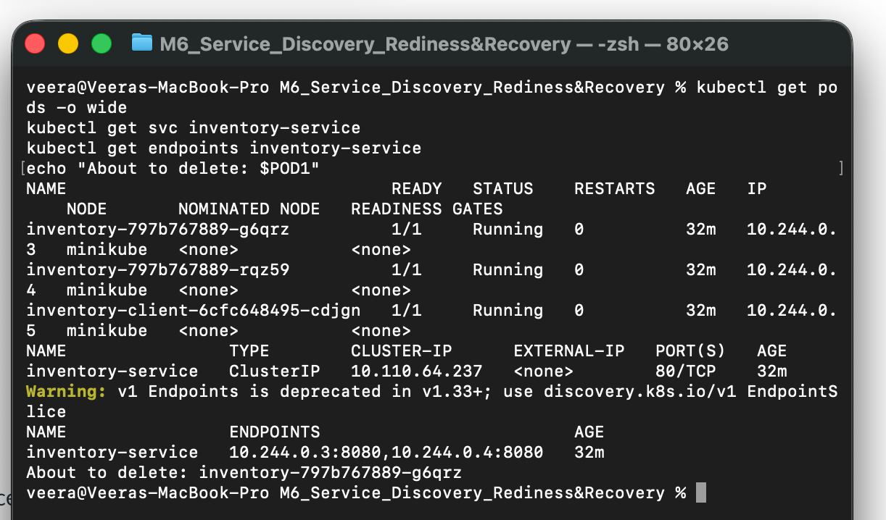

**During deleting:** the old Pod goes to `Terminating`. Kubernetes starts a new Pod, `inventory-797b767889-cx9vn`, which goes Pending, ContainerCreating, then Running. (The `Error` lines at the end are just the old container stopping.)

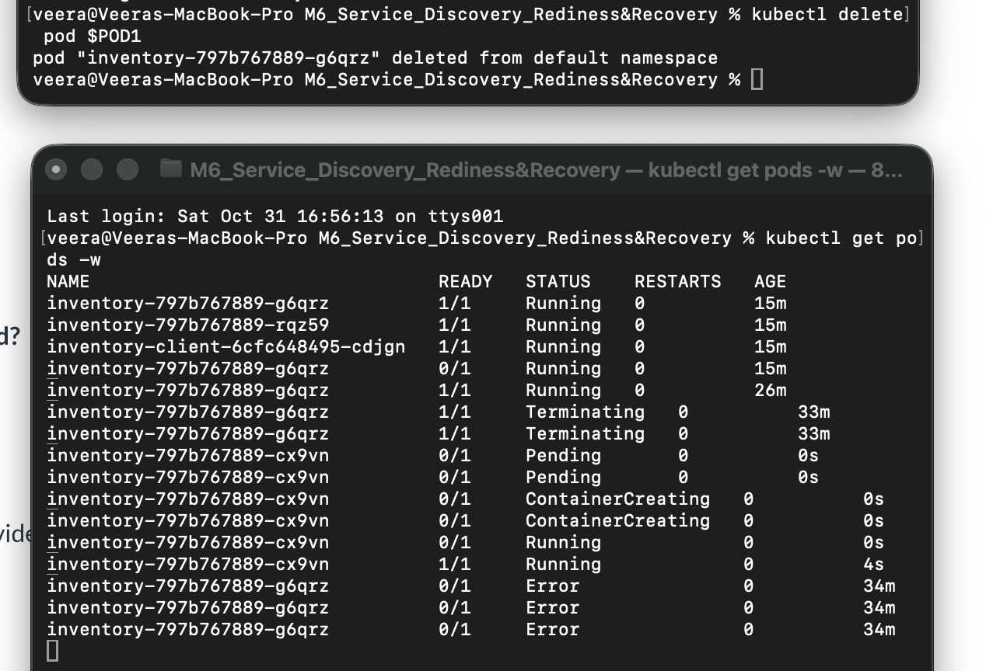

**After the replacement:** the new Pod has a new name and a new IP (`10.244.0.6`). The Service ClusterIP is the same, the endpoints updated by themselves, and the Deployment shows `2/2`.

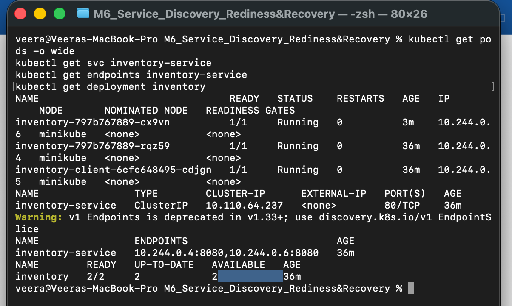

**Old name and new name:**

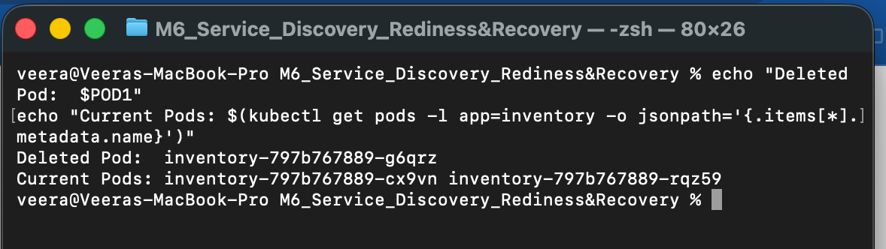

**The client kept working** with the same Service name. It now gets answers from the new Pod too.

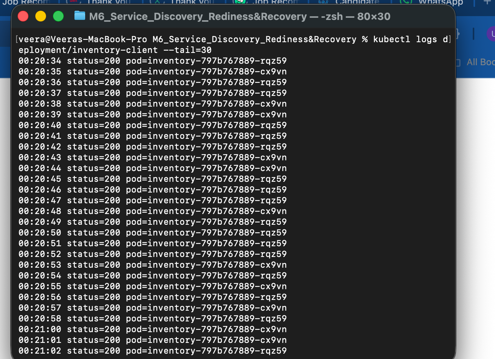

**Events** show `Killing` for the old Pod and `SuccessfulCreate` for the new one.

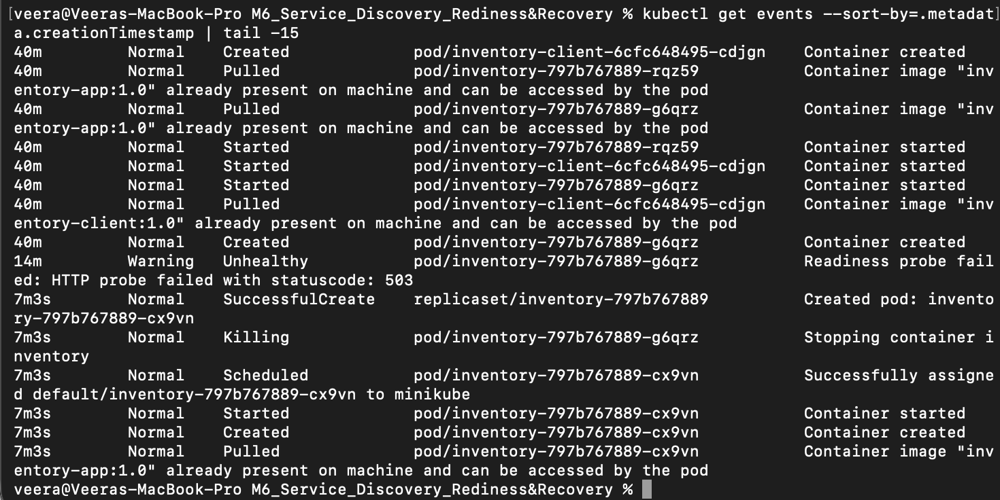

| | Before | After |
|---|---|---|
| Pod name | `inventory-797b767889-g6qrz` | `inventory-797b767889-cx9vn` |
| Pod IP | `10.244.0.3` | `10.244.0.6` |
| Service name | `inventory-service` | `inventory-service` |
| Service ClusterIP | `10.110.64.237` | `10.110.64.237` |

Text files: `pods-before-deletion.txt`, `pods-after-replacement.txt`, `endpoints-after-replacement.txt`, `client-logs-after-deletion.txt`, `events.txt`, `error-count.txt` (in `Evidences/`).

## Why is a stable Service name useful when Pods can fail or be replaced?

A stable Service name is useful because Pods can fail or be replaced, and each new Pod gets a new name and a new IP. The client does not need to know about this, because it always calls the same name, `inventory-service`. In my test, one Pod became unready and another Pod was deleted, and the client still worked without any change. Kubernetes updates the list of Pods behind the Service by itself. Because of this, the client and the Pods are not tightly connected, and the system can recover on its own.

